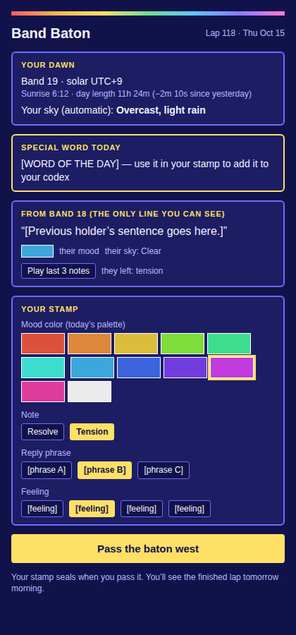
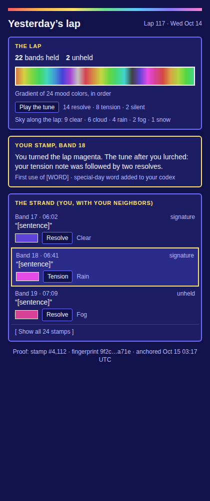
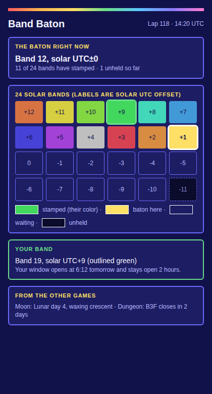

# Band Baton: design notes

A daily check-in game synced to the real sun, companion to the Moon game (Daily Digital Demon Dungeon). Notes from the design conversation, Oct 15 2026. Everything here is still a draft.

## Your design language (context)

- A shared clock with private contents.
- An append-only record that players leave a lasting mark on.
- Scarcity that stays gone once it's gone.
- Small structured inputs (tags, indices) instead of free text.
- A gentle tone where nothing is really punishing.
- Connecting the digital world to the real one.

The principle from the other bot: make the passage of time produce history, instead of only restricting when people can play.

## Core idea

Sunrise travels west around the planet once a day. A baton rides that line. Each player holds it briefly at their own solar sunrise, adds one stamp, and passes it on.

- **24 fixed bands**, each 15 degrees of longitude wide (one solar hour). Objective, based on the globe. Never redrawn, never recomputed.
- **Solar time, not civil time.** Band = longitude only, so it is stable all year. Show "your band: solar UTC+9" next to local time, because bands differ from time zones (western Spain, China).
- **A lap takes 24 hours**, one band per hour.
- **Everyone in a band is awake at roughly the same time**, which gives simultaneity with no scheduling.
- **Thin player base:** any one player in a band can catch the baton. Empty bands show as *unheld*, or are held by bots. The silence is part of the record. A planet of lit and dark bands fills in as players arrive.
- **Catch window:** a couple of hours after the band's sunrise (placeholder number).

## What a lap is

One lap is one trip of the baton around the planet, which is also one day (24 hours).

- It starts at the date-line band (solar UTC+12) at its 6:00 solar sunrise.
- It moves west one band per hour, and each band gets one catch window per lap.
- It closes about 23 hours later at the last band, and the finished lap seals.
- Each player stamps once per lap and sees the finished lap by their next dawn.
- A lap straddles two calendar dates for most players. Open: a naming rule, such as naming each lap by the UTC date it starts on.
- The lap closes only about an hour before the date-line band catches again, so late-catch rules matter at that edge.

## What a stamp is

All picked from lists. No free text, no player-drawn pictures.

| Thread | Source | Reacts to the previous holder? |
|---|---|---|
| Sky report | Automatic from a weather service (plain wording: "Overcast, light rain") | No |
| Solar calendar | Computed (sunrise, day length change, solstice/equinox) | No |
| Mood color | Player picks from today's palette | No |
| Note | Resolve or tension, after hearing the last 2-3 notes | Partly |
| Sentence | Preset phrases answering the line before | Yes |
| Feeling / gesture / sign-off | Picked from lists | No |

- Any slot can be left blank. A minimal stamp is valid.
- Each holder sees only the line before theirs (story-telephone).
- Wrong notes are possible. Players choose intent (resolve or tension) and the game never judges.
- A lap ends with three artifacts: a **gradient** (24 mood colors), a **tune** (24 notes), and a **strand of sentences**, with the real weather running alongside.
- Objective color (sky) and subjective color (mood) are two layers of the same stamp.
- Reacting and not reacting are both needed, and the current mix is good. If stamping starts to feel like homework, lighten the sentence side.

### Palette

The mood palette was getting too complicated. Fallback: one fixed palette of about 8-12 colors whose selection shifts with the season. Optional ideas that were discussed: date-seeded variation, both-season halves, a small moon tint.

### Words are items

- Full word lists available from day one, so nobody is blocked from expressing themselves.
- **Gated words** are added on top as flair, never as the only way to say something:
  - Calendar words (solstice, equinox, eclipse, moon phases). Eclipse words are rare because eclipses are.
  - Achievement words (streaks, first catches, holding a usually dark band).
  - Discovery words (revealed when first used).
- The special word of the day is shown on the catch screen.
- Using a word in a stamp adds it to your codex. The codex is derived from sealed stamps, so no separate table.
- "First to use a word" is just the earliest stamp containing it. No extra record or announcement.
- Because stamps store indices, the same strand can display in any language later.
- Open: whether codexes are public or private. Parked.

## The ledger

- **One chain, not two.** Privacy comes from visibility rules, like scoundrel.exe (hidden until the day is over).
- Sealed: each stamp (lap, band, indices, previous hash, time) and each unheld gap.
- Visible always: that a stamp happened, which band, when.
- Hidden until the lap closes: contents.
- Never in the ledger: accounts, coarse location, raw weather data.
- Reuse the sealing code and the hourly OpenTimestamps anchoring. Add a `stamp` kind.
- The ledger shows up as strands and a small "proof" line on closed laps (chain position, fingerprint, anchor receipt). Players are never shown "the ledger" directly.
- Pictures: the ledger would seal an image's hash, not the image. For the baton, art can be composed from the stamp's indices, so no pictures need storing.

## Daily rhythm

1. Open the game in your dawn window.
2. See only the previous stamp. Hear the last few notes.
3. Your sky tag fills in automatically.
4. Pick your mood color, note, phrase, and other slots.
5. Pass the baton west. About a minute.
6. Next morning: see how yesterday's lap ended, with your stamp marked in it.

The reward is deliberately delayed. The payoff names your contribution ("you turned the lap magenta"), and laps can have a sealed outcome.

Open: whether each lap gets a prompt or theme, or sentences wander freely.

## Connections to the other games

- Each game keeps its own rules. The shared world is shared memory and shared clocks.
- **The surface:** the Dungeon's pit belongs to the moon, and the surface (climbing out) belongs to the sun. The baton is what you find up there.
- The Dungeon's sky view can show which band holds the baton (read-only).
- Daylight can act as a small flavor condition in the Dungeon, like moon phase does.
- Baton milestones appear in the Dungeon's title cards and feeds, and the reverse.
- Later: an item you can carry down the pit, and a cross-game monthly almanac sealed in the anchors repo.
- Related ideas: a dusk lantern as a companion, and scheduled solstice/equinox events.

## Mockups

Cleaner 88x31 style: dark navy, bordered panels, mood colors as small button swatches. All text is placeholder. Live version: https://claude.ai/artifact/BMg4QQm3WeMmpPzizbCuJY

### 1. The catch

### 2. Morning payoff

Note: the third strand row is labeled "unheld" but shows a sentence. An unheld band should show no stamp content.

### 3. Planet view

## Build order (first version)

What already exists and can be reused:

- Ledger sealing and hourly OpenTimestamps anchoring (Dungeon, 88x31), with a new `stamp` kind.
- Sun math in sky.js. Bands come from longitude alone.
- Accounts: save codes and passkeys from scoundrel.exe and 88x31.

What is new work:

- The 24-band baton and handoff logic.
- The stamp lists.
- A weather lookup.
- The three screens.

Suggested order:

1. **The baton alone.** 24 fixed bands, the baton moving west one band per hour, bots holding empty bands, and each stamp sealed to the ledger. Unheld gaps seal too.
2. **A minimal stamp.** Automatic sky tag, mood color, and resolve or tension. No sentences yet.
3. **The three screens.** Catch, morning payoff, and planet view.
4. **Play it for a few days.** Check whether the one-minute ritual feels good and whether the delayed payoff is rewarding.
5. **Add later:** preset sentence phrases, feeling and gesture lists, the word lists and codex, calendar-gated words, and the Dungeon connections (sky view marker, title cards).
6. **Much later:** the surface link in the Dungeon, carried items, and the cross-game almanac.

## Open questions

- Stamp signatures: a permanent glyph or color, a player name, or anonymous.
- Is the player's own mood color all they pick, or does any color react to the previous one?
- Lap prompt versus free-wandering sentences.
- Codex visibility.
- Palette size and whether to keep the seasonal shift.
- Weather API terms for non-commercial versus commercial use.
- How the catch window works for people who miss it (late catch versus skip).
